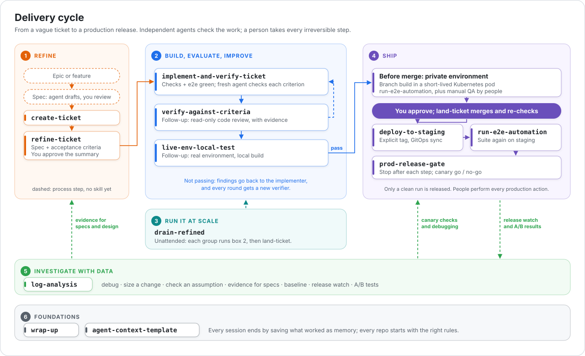

# Josh's shared skills

Agent skills for a team's delivery cycle: from a vague ticket to a production release. Whatever agents, code and tests can verify is verified that way; a person decides what gets built and takes the irreversible steps outside the repository. Written for Claude Code and Codex. All examples use a fictional stack (a TypeScript/React app, GitHub Actions, Argo CD, a Splunk-style log search).

 Click the diagram to open it full size.

## Ticket workflow

Four skills carry one ticket from idea to review, with the same states everywhere:

| State | Set by |
|---|---|
| Backlog | `create-ticket` |
| Refined | `refine-ticket` |
| In progress | `implement-and-verify-ticket`, when work starts (its PR uses `Refs #N`, never a closing keyword) |
| In review | `land-ticket` (merged, deployed, re-checked; when driving step by step, the person tries it) |
| Done | `land-ticket` directly, when the project sets "Landed tickets go to: Done" (the deployed check is the gate); or a person, after trying it, when the project keeps In review |

What one stage hands the next:
- **Refinement summary** (one comment per ticket): the only list of acceptance criteria. Each criterion has a phase, `local` (checked on the branch), `PR` (its CI run) or `deployed` (the live site), and is checkable read-only or names its probe. Changes to the live system (settings, rulesets, hosting) are **landing steps**, run by `land-ticket`, not by the implementer. Deferred work becomes new tickets in the same approval.
- **PR**: title ends `(#N)`, body has `Refs #N`, the criteria table with evidence, the code-review verdict and the landing steps.
- **Landing comment**: PR, deploy run, deployed checks, a checklist for a person who wants to try it.

Going back: changes asked for in review (by a person, when driving step by step) stay In progress and the next implement run continues on the PR; a closed PR or a revert sends the ticket to Refined; a problem found in review sends it to In progress (small fix) or Refined (plan changes), with a comment. `implement-and-verify-ticket` has the full table.

Asking an agent to implement or land a ticket (or starting `drain-refined`) is the approval for that stage's state moves and its landing comment; anything else posted on a ticket (new tickets, refinement summaries) is shown to the user first. The skills stay generic. Each project states its own settings in `AGENTS.md` under "Ticket workflow settings" (tracker, default branch, board or labels, commands, deploy); `agent-context-template` has the block.

## Two ways to run it

Whatever agents, code and tests can verify is verified that way, in both modes: the project's checks, a fresh behaviour verifier, a fresh code reviewer, CI on the PR and a fresh check on the deployed site. Manual verification is what a person chooses to add; it is not a required stage.

- **Unattended (`drain-refined`).** A ticket factory: refined tickets go in, verified and landed changes come out. It has to run without anyone, so a manual approval inside it would stop it; starting the run is the approval. A change merges only when every machine gate passes, with no manual verification in between. A person samples the results afterwards. Projects that run this way set "Landed tickets go to: Done" (the deployed check is the gate).
- **Step by step** (a person runs `refine-ticket`, `implement-and-verify-ticket` and `land-ticket` one ticket at a time). This is how a person tests, debugs and tunes the workflow itself, or steers one ticket closely. The person verifies and approves by hand: approves the refinement, reviews the PR, says "land it", tries the result. The machine gates still run and must still pass; the person's review is in addition to them. What a person learns this way goes back into the skills, which makes the unattended mode better. Projects that work this way keep the default, In review.

In both modes a person decides what gets built (tickets, refinement summaries and landing steps are shown and approved first) and performs the irreversible steps outside the repository: production release actions (`prod-release-gate`). These are the exceptions to "machines first".

## Skill groups

### 1. Refine
Flow: an epic or feature is turned into a spec or PRD (the agent drafts, you review), the spec is broken down into tickets, and each ticket is refined. Drafting the spec has no skill yet.

| Skill | What it does |
|---|---|
| `create-ticket` | Splits a PRD (or one request) into tickets with a fixed format, checkable acceptance criteria and dependencies. Drafts locally; creates them in the tracker, in dependency order, only after the user approves. Re-runs skip tickets already created. |
| `refine-ticket` | Refines a ticket with the user into an implementation-ready spec. One consensus comment, updated on re-run: criteria with phases, landing steps, out of scope. Deferred work becomes new tickets and PRD changes are proposed in the same approval. The user approves before anything is posted; then the ticket moves to Refined. |

### 2. Build, evaluate, improve
Implement a task, then evaluate the result with independent subagents, and feed the findings back until it passes. The implementer never grades itself.

| Skill | Role in the loop |
|---|---|
| `implement-and-verify-ticket` | Implements in a worktree (or continues an open PR after review). Gate: type check, lint, unit tests and the e2e tests covering the change pass; a fresh subagent checks every `local` criterion with evidence, in a browser (Chrome DevTools MCP) where it can be seen, otherwise by a test or command; a second fresh subagent runs `verify-against-criteria`. Fix and re-verify with new subagents until both pass; opens a PR. |
| `verify-against-criteria` | Evaluation: read-only code review of the diff, verdict (PASS / PASS-with-remarks / GAPS / DEFECTS) with evidence per acceptance criterion; criteria the diff cannot implement (settings, live site) are n/a. |
| `live-env-local-test` | Evaluation: routes chosen requests from a real non-production environment to the local server and checks the flow in the browser (Chrome DevTools MCP). |

`verify-against-criteria` and `live-env-local-test` run as a **follow-up step in a separate subagent**: the implementer finishes, a fresh agent that never saw its reasoning checks the result.

### 3. Run it at scale
| Skill | What it does |
|---|---|
| `drain-refined` | Unattended: takes every Refined ticket, groups compatible ones into PRs, and per group runs a fresh implementer, a fresh behaviour verifier and a fresh code reviewer, with bounded fix rounds, then opens the PR and runs `land-ticket`. One group at a time; the orchestrator keeps only a ledger. A group that cannot pass is split, then skipped with a comment; a failed landing stops the run. Starting it is the approval for its merges; only machine gates decide, nobody approves in between; tickets end In review or Done, per the project's setting (Done fits this mode). |

### 4. Ship
Before the merge, a private environment is built from the branch; the automated suite runs there and people do manual QA. After the merge, the build goes to staging and the suite runs again. Only a clean run goes to production.

| Skill | What it does |
|---|---|
| `deploy-to-staging` | Triggers a deploy workflow with an explicit tag and waits for the GitOps sync. Also builds a short-lived private environment from an unmerged branch. The user confirms tag, environment and region. |
| `run-e2e-automation` | Runs the end-to-end suite on a chosen non-production environment, classifies each failure as real, flaky or environmental, and reports a verdict. |
| `land-ticket` | After the user says "land it" (or starts `drain-refined`): checks green and `PR` criteria hold, landing steps before merge, merge, confirm the merge, landing steps after merge, wait for the deploy, a fresh subagent checks the `deployed` criteria on the live site, ticket to In review with evidence and a checklist for a person who wants to try it, or closed as Done when the project chose that. |
| `prod-release-gate` | Release checklist with a stop after every step, canary go/no-go from metrics and logs, rollback prepared first. A person performs every production action; production is irreversible, so this stays human in every mode. |

### 5. Investigate with data
| Skill | What it does |
|---|---|
| `log-analysis` | Turns a question into queries, links and dashboards, and answers with evidence. Used before the work (sizing, assumptions, evidence for specs and designs) and after release (monitoring, debugging, A/B test analysis). Debugging is only one mode. |

### 6. Foundations
| Skill | What it does |
|---|---|
| `wrap-up` | Closes a session: saves the successful path as long-term memory so the next session follows it, updates docs, tidies, commits, reports. |
| `current-docs` | Looks up the current docs for the installed version of each library and tool (Context7, bundled script or MCP) before code is written or approved; implementers follow them and reviewers flag deprecated or non-recommended use with the doc source. |
| `agent-context-template` | An `AGENTS.md` and a small context index (progressive context discovery) so agents follow the project's architecture and current syntax. |

## Design principles

1. **Producer is not the checker.** Every gate runs in a fresh context.
2. **Machines verify what machines can; a person takes the irreversible steps.** Agents, code and tests verify everything that is reversible and checkable, in both modes. A person takes the irreversible steps outside the repository (production actions) and decides what gets built (new content posted on a ticket: tickets, refinement summaries). A merge is asked for (`land-ticket`) or approved by starting `drain-refined`; step by step, the person also reviews it by hand.
3. **Bounded loops.** A few fix rounds, then a person decides.
4. **Compact orchestration.** Orchestrators plan and keep a ledger; subagents do the work.
5. **Evidence over opinion.** Decisions come with queries, counts and charts.
6. **Memory of what worked.** `wrap-up` captures the successful path.
7. **Small tickets.** Refinement splits work until each ticket can be implemented and verified in one sitting. Together with bounded loops, that keeps each run short and its cost predictable.

## Trust ladder

Who holds each step. The agents do the work in between; a step moves up a rung only after the team has a record of its gate being reliable:

1. **Agent proposes, person does.** Irreversible actions outside the repository: production actions today.
2. **Agent drafts, person approves.** What to build: tickets and refinement summaries (shown before posting). Step by step, also each result: the PR review and the request to land.
3. **Agent does, the gates decide, person samples.** `drain-refined`: merges of tickets whose checks, browser verification, code review and deployed check are all green; the person samples the results afterwards.
4. **Agent does, person is told.** Only for steps with a long clean record and a cheap undo.

Moving a step up is a team decision that changes the skill's own rules, never something an agent decides for itself.

## Install

Copy a folder from `skills/` into `.claude/skills/` (Claude Code) or `~/.codex/skills/` (Codex). Skills are plain markdown; adapt the commands to your stack.

## License

MIT.
